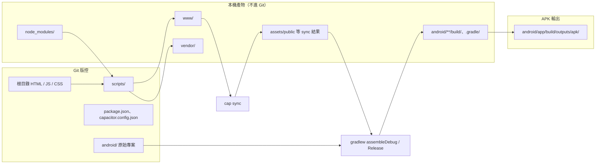

# 專案目錄與版控說明

本文件說明 **mobileShoppingAPP** 哪些目錄應納入 Git、哪些僅在本機產生、以及與 **Android APK 打包** 相關的路徑。規則以根目錄 [`.gitignore`](../.gitignore) 與 [`android/.gitignore`](../android/.gitignore) 為準。

## 概覽

此專案是 **HTML / JavaScript 網頁** + **Capacitor Android 殼**。版控保存「可還原的原始碼與 Android 專案設定」；依賴、staging 網頁、Gradle 建置產物與 APK 則不提交，改由指令在本機重建。



## 一、應納入 Git 版控

Clone 後應能還原 App 邏輯、建置腳本與 Android 原生專案骨架（不含建置快取與產物）。

### 根目錄

| 路徑 | 說明 |
|------|------|
| `index.html`、`styles.css` | 主頁與樣式 |
| `app.js` | 主應用邏輯 |
| `ocr-service.js` | OCR 辨識 |
| `product-manager.js` | 商品管理 |
| `price-calculator.js` | 特價計算 |
| `capacitor.config.json` | Capacitor 設定（`webDir` 為 `www`） |
| `package.json`、`package-lock.json` | npm 依賴與腳本鎖定 |
| `README.md` | 使用與打包說明 |
| `.gitignore` | 忽略規則 |

### `scripts/`

| 路徑 | 說明 |
|------|------|
| `copy-web.mjs` | 組裝 `www/` 與根目錄 `vendor/tesseract/`（OCR 離線資源） |
| `dev-server.mjs` | 本機開發用 HTTP 伺服器 |
| `verify-promotions.mjs` | 特價邏輯驗證（開發用） |

### `android/`（僅「原始專案」部分）

| 路徑 | 說明 |
|------|------|
| `build.gradle`、`settings.gradle`、`variables.gradle`、`gradle.properties` | Gradle 專案設定 |
| `capacitor.settings.gradle` | Capacitor 與 Android 整合 |
| `gradlew`、`gradlew.bat`、`gradle/wrapper/` | Gradle Wrapper |
| `app/build.gradle`、`app/capacitor.build.gradle`、`app/proguard-rules.pro` | App 模組建置 |
| `app/src/main/` | `MainActivity`、Manifest、資源圖示與 splash 等 |
| `app/src/test/`、`app/src/androidTest/` | 測試骨架 |
| `android/.gitignore`、`app/.gitignore` | Android 子專案忽略規則 |

**注意：** `android/` 目錄本身要版控，但其中的 `build/`、`.gradle/`、`local.properties` 等已在 ignore 中，不應提交。

## 二、本機才需要（不進 Git）

這些路徑可由指令或本機 SDK / IDE 重新產生，或含機密、個人路徑。

| 路徑 | 產生方式 / 用途 |
|------|------------------|
| `node_modules/` | `npm install` |
| `www/` | `npm run copy:web`（Capacitor 打包用的 web 根目錄） |
| `vendor/` | `copy-web.mjs` 從 `node_modules` 複製 Tesseract 檔案；內容會再複製到 `www/vendor/` |
| `android/.gradle/`、`android/build/`、`android/app/build/` | Gradle 建置與快取 |
| `android/local.properties` | Android Studio 寫入的 SDK 路徑（每台機器不同） |
| `android/.idea/`、`android/captures/` | IDE 設定與除錯擷圖 |
| `*.apk`、`*.aab` | 安裝包產物 |
| `*.keystore` | Release 簽章金鑰（勿提交） |
| `.DS_Store` | macOS 系統檔 |

### Capacitor sync 會覆寫的 Android 路徑

執行 `npm run cap:sync`（內含 `copy:web`）後會更新下列項目，已在 `android/.gitignore` 排除：

- `android/app/src/main/assets/public`（WebView 實際載入的網頁）
- `android/app/src/main/assets/capacitor.config.json`
- `android/app/src/main/assets/capacitor.plugins.json`
- `android/app/src/main/res/xml/config.xml`
- `android/capacitor-cordova-android-plugins`

### 其他（非 App 執行必要）

| 路徑 | 建議 |
|------|------|
| `.agents/` | Cursor 任務紀錄；若不需要與團隊共享，可加入 `.gitignore` |

## 三、與產生 APK 相關的目錄

APK 不是版控內的固定資料夾，而是 **在本機對 `android/` 執行 Gradle 建置** 後的輸出。

| 階段 | 路徑 / 指令 |
|------|-------------|
| 網頁 staging | `www/`（含 `vendor/tesseract`） |
| 同步進原生專案 | `npm run cap:sync` → `android/app/src/main/assets/public` |
| 建置工具 | JDK 17 或 21、Android SDK（見 `android/local.properties`） |
| Debug APK | `npm run android:debug` → `android/app/build/outputs/apk/debug/app-debug.apk` |
| Release（未簽章） | `cd android` 後 `gradlew.bat assembleRelease` → `android/app/build/outputs/apk/release/app-release-unsigned.apk` |
| Release 簽章 | 本機 `release.keystore` + SDK Build-Tools 的 `zipalign` / `apksigner`（詳見 [README](../README.md)「打包 Android APK」） |

改過根目錄的 HTML、JS 或 CSS 後，**打包前務必** 先執行 `npm run cap:sync`，否則 APK 內仍是舊版網頁。

## 四、Clone 後還原步驟

### 僅在瀏覽器開發

```bash
npm install
npm run copy:web
npm run serve
```

瀏覽器開啟 `http://127.0.0.1:8080`。

### 建置或安裝 Android App

```bash
npm install
npm run cap:sync
npm run android:open
```

或在專案根目錄：

```bash
npm run android:debug
```

第一次請用 Android Studio 開啟 `android/`，讓其下載 SDK 與完成 Gradle 同步。

## 五、快速對照表

| 分類 | 典型路徑 |
|------|----------|
| **Git** | 根目錄網頁與 JS、`scripts/`、`package*.json`、`capacitor.config.json`、`README.md`、`.gitignore`、`android/` 原始檔（非 build / sync 產物） |
| **本機可重建** | `node_modules/`、`www/`、`vendor/`、`android/**/build/`、`android/.gradle/`、Capacitor sync 產物、IDE 設定 |
| **APK 流程** | 輸入：`www` + sync；建置：`android/` + Gradle；輸出：`android/app/build/outputs/apk/` |

## 相關文件

- [README.md](../README.md) — 功能說明、Android 環境、Debug / Release 打包步驟
- [capacitor.config.json](../capacitor.config.json) — `webDir: www` 等設定
- [scripts/copy-web.mjs](../scripts/copy-web.mjs) — 複製到 `www/` 的檔案清單與 OCR 資源組裝
